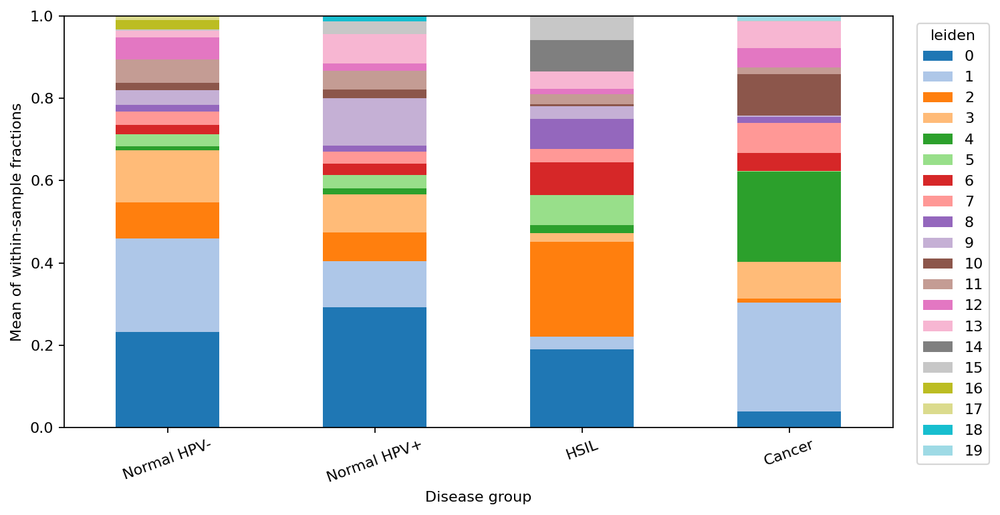

# From Cytomorphology to Cell State

**An exploratory single-cell analysis of cervical disease using GSE208653.**

What changes in epithelial transcriptional states and the cellular microenvironment
across HPV-negative normal tissue, HPV-positive normal tissue, HSIL, and cervical
cancer? Which apparent stage patterns recur across individual samples?

My previous work with PAP-smear cytology made me curious about the molecular
programs behind cervical-cell changes. This project explores the same disease from
the scale of individual cells, using Python and Scanpy to reanalyze a public cohort
of nine cervical-tissue samples. I focused on retaining sample identity, checking
whether patterns recur across samples, and treating cell labels as provisional.
Implementation and execution were assisted by a coding assistant; the repository
records that assistance, the analysis choices, and the questions that came up.

## Results

The executed workflow retained **68,803 of 83,959 cells** after the stated QC
filters. It recovered **12,690 provisionally annotated epithelial cells** for
subset analysis across the nine samples. These are cell counts from deposited
matrices; they do not estimate the abundance of cell types in cervical tissue.

One epithelial Leiden cluster (cluster 4) was represented in all three cancer
samples at 17%, 26%, and 23% of each sample's recovered epithelial cells, versus
0–4% in each non-cancer sample. Its top cell-level markers included **CEACAM5**
and **CEACAM6**. This is a candidate cancer-associated state in this dataset, not
a malignant-cell call or validated marker. A different cluster (cluster 2) was
most represented in HSIL, averaging 23% of epithelial cells across its two
samples. Other clusters varied markedly between samples, including the two
HPV-negative normal samples, which cautions against treating the group averages
as a smooth progression.

The held-out cancer-panel exercise selected genes using the other two cancer
samples and non-cancer samples, then scored the omitted sample. All three held-out
scores were above the training non-cancer mean (differences of 2.14, 3.46, and
2.89 logCPM units on the panel's mean score). This is an exploratory within-cohort
transfer result: annotation used the full cohort, cancer histology differs across
samples, and only three cancer samples are available.

The sample-corrected clustering changed substantially from the uncorrected
clustering (adjusted Rand index 0.47 across all cells and 0.31 in epithelial
cells). In epithelial cells, the median fraction of each cluster contributed by
its largest sample fell from 0.98 before correction to 0.43 after correction.
This measures sensitivity to the correction step; it does not establish that
Harmony removed only technical variation. Stage and sample are linked, so some
real disease signal may also have been attenuated.



The bars show equal-weight averages of within-sample cell fractions. Cluster
numbers are analysis labels, not cell identities or stages; see the marker table
and sample-level chart before interpreting a cluster.

## From cytomorphology to molecular phenotype

| Cytology perspective | Single-cell perspective |
|---|---|
| Cellular morphology | Gene-expression state |
| Dysplastic epithelial appearance | Heterogeneity of epithelial transcriptional states |
| HPV-associated cellular changes | Expression patterns across HPV-status groups |
| Increasing atypia across disease categories | Cross-sectional differences in molecular programs |
| Inflammatory background | Recovered immune-cell composition and expression |

**The cytology and scRNA-seq samples are not paired.** This project does not map
a specific PAP-smear morphology to a transcriptomic cluster. Its clinical group
ordering does not demonstrate that individual cells or patients progressed through
those stages.

## Reproduce the analysis

Python 3.10 was used. From the repository root:

```powershell
python -m venv .venv
.\.venv\Scripts\Activate.ps1
python -m pip install -r requirements-lock.txt
$env:NUMBA_NUM_THREADS = '4'
$env:OMP_NUM_THREADS = '4'
$env:OPENBLAS_NUM_THREADS = '4'
python run_analysis.py
python validate_results.py
python -m unittest discover -s tests -v
```

On Linux/macOS, activate with `source .venv/bin/activate` and set the thread
variables with `export`. `environment.yml` is an alternative Conda environment.
The full dependency lock records the executed environment; `requirements.txt`
lists direct and compatibility-critical dependencies.

The first run downloads approximately 614 MiB of public count matrices. Large
data and AnnData checkpoints stay local. Allow several GB of disk space and enough
memory for sparse matrices plus temporary marker-ranking blocks; a 16 GB machine
is a practical starting point. Runtime depends on hardware and first-run compilation.

`--resume` uses existing counts, annotated, or epithelial checkpoints. It is
intended for an interrupted run with the **same parameters**. Remove stale
checkpoints before changing QC, genes, annotation, or clustering. Individual
stages are available through `--stage qc`, `cluster`, `epithelial`, or `robustness`.

### Notebook walkthroughs

The seven notebooks explain the completed workflow and contain code cells for
inspecting its tables, figures, and checkpoints. They do not repeat the full
cohort analysis. After running the pipeline locally, execute the notebook cells
to view the saved outputs; checkpoints are excluded from GitHub because of their
size.

1. [Data loading](notebooks/01_data_loading.ipynb)
2. [Quality control](notebooks/02_quality_control.ipynb)
3. [Integration and clustering](notebooks/03_integration_clustering.ipynb)
4. [Cell-type annotation](notebooks/04_cell_type_annotation.ipynb)
5. [Epithelial states](notebooks/05_epithelial_progression.ipynb)
6. [Markers and sample-level expression](notebooks/06_differential_expression.ipynb)
7. [Sample robustness and trajectory](notebooks/07_patient_robustness.ipynb)

To rebuild the walkthrough notebooks:

```powershell
python build_notebooks.py
```

## What to inspect

- [Methods and limitations](docs/methods.md): exact thresholds, annotation rule,
  integration comparison, expression scores, held-out panel design, and trajectory.
- [Questions and execution log](docs/learning_log.md): issues, resolutions, and
  scientific uncertainties.
- [Data provenance](data/README.md) and [sample mapping](data/metadata/samples.csv).
- `figures/`: QC, baseline and corrected UMAPs, marker evidence, composition,
  signatures, held-out panels, and exploratory pseudotime.
- `results/`: numerical tables, gene coverage, integration diagnostics, and
  validation manifests.

## Interpretation boundaries

Cell-type labels are marker-based and provisional. An epithelial cluster is not
automatically malignant. Recovered-cell fractions are not tissue abundance. The
cohort has only two or three samples per group, including heterogeneous cancer
filenames, so disease, sample, histology and technical effects can be intertwined.
Doublets and ambient RNA are not separately modeled.

Cell-level cluster marker p-values are descriptive, not evidence for replicated
disease differences. Pseudobulk differences and held-out panel transfer are
exploratory; upstream labels use the full cohort, so the transfer exercise is not
fully nested independent validation. Harmony may remove real stage biology.
Pseudotime is rooted graph distance, not proof of disease progression. No clinical
biomarker, paired morphology association, or causal HPV claim is made.

## Sources

- [GEO GSE208653](https://www.ncbi.nlm.nih.gov/geo/query/acc.cgi?acc=GSE208653):
  cohort metadata and deposited expression matrices.
- [Guo et al., original study](https://pmc.ncbi.nlm.nih.gov/articles/PMC10040725/):
  biological context and published epithelial marker hypotheses.
- [Scanpy preprocessing and clustering](https://scanpy.readthedocs.io/en/1.10.x/tutorials/basics/clustering.html):
  workflow and API reference.
- [Harmony](https://github.com/slowkow/harmonypy): sample correction of PCA coordinates.
