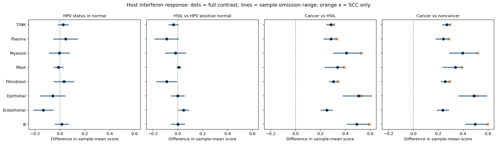
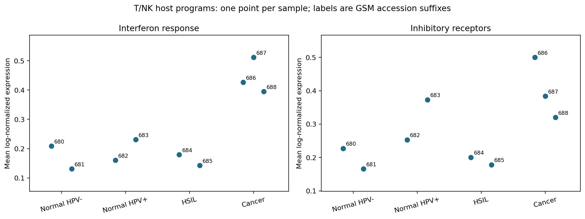

# Cell-type-specific host responses: sample-level evidence

This extension asks which host expression programs differ with HPV status in
normal tissue and across lesion categories, and whether their direction depends
on one sample. It uses all 68,803 QC-passing cells with the existing provisional
annotations. Eight non-ambiguous cell types contribute to 128 descriptive contrasts.

## What changed

The previous immune summaries pooled several cell types or focused on T/NK cells.
The new analysis evaluates four existing panels separately within each broad cell
type: interferon response, cell cycle, cytotoxicity, and inhibitory receptors.
It retains one score per sample and cell type, requiring at least 20 cells.
These host panels were already in the repository; none is a viral-expression score.

Four contrasts distinguish HPV status within normal tissue from later lesion
differences: normal HPV+ minus normal HPV-, HSIL minus normal HPV+, cancer minus
HSIL, and cancer minus all non-cancer samples. Each sample contributes equally.
The pooled non-cancer reference weights samples, not clinical stages; its six
samples happen to give each of the three non-cancer stages equal weight here.

## Demonstration



Dots are full-cohort differences in mean log-normalized panel expression. Lines
span the differences after omitting each eligible sample in turn. Orange crosses
exclude the ADC-labelled cancer sample, retaining eligible SCC-labelled samples.
An orange cross is omitted if fewer than two SCC samples pass the cell-count rule
for that cell type. All group sizes are retained in the exported tables.
All panels share the same horizontal scale. These ranges are **not confidence
intervals** and there are no significance or causal claims.

| Cell type | Normal HPV+ minus HPV- | Omission range | Cancer minus HSIL | Omission range |
|---|---:|---:|---:|---:|
| Epithelial | -0.0577 | -0.1542 to +0.0388 | +0.5061 | +0.3840 to +0.6082 |
| T/NK | +0.0257 | -0.0134 to +0.0647 | +0.2834 | +0.2497 to +0.3080 |
| Myeloid | -0.0049 | -0.0844 to +0.0747 | +0.4089 | +0.3069 to +0.5301 |

For these three cell types, the normal-tissue HPV-status contrast changes direction
when individual samples are omitted. The cancer-versus-HSIL interferon differences
remain positive under each omission. Excluding the ADC-labelled sample gives
differences of +0.5261, +0.3080, and +0.5301 respectively. That is within-cohort
sensitivity evidence, not independent replication or a histology-adjusted model.



The T/NK inhibitory-receptor panel rises from HPV-negative to HPV-positive normal
tissue (+0.1169), falls in HSIL relative to HPV-positive normal (-0.1240), then
rises in cancer relative to HSIL (+0.2119). Each direction survives single-sample
omission, but the pattern is not monotonic. Receptor expression alone does not
establish exhaustion, and the combined T/NK label can conceal shifts in subtypes.

## Can the matrices support viral integration analysis?

All nine original feature files contain 20,615 feature rows and **zero explicitly
HPV/papillomavirus-labelled rows** under the documented label scan. This audits
the deposited feature labels before this project's QC. It does not prove absence
of viral reads, infection, or integration. Unlabelled viral accessions may evade a
name-based scan. Human host-response scores cannot substitute for viral counts.

The current artifacts provide no host-virus breakpoint evidence, scATAC fragments,
or paired RNA/chromatin barcode map. See the [project alignment](professor_alignment.md)
for the input requirements and proposed next milestone.

## Reproduce and inspect

After running the primary analysis and retaining its raw feature files:

```powershell
python -m src.host_response
python -m unittest discover -s tests -v
```

- [Sample/cell-type scores and eligibility](../results/host_response/sample_cell_type_scores.csv)
- [All contrasts, omission ranges, and SCC sensitivity](../results/host_response/contrasts.csv)
- [Every omitted-sample calculation](../results/host_response/sample_omission_folds.csv)
- [Panel gene coverage](../results/host_response/gene_coverage.csv)
- [Feature-label audit and checksums](../results/host_response/viral_feature_audit.csv)
- [Skipped contrasts](../results/host_response/skipped_contrasts.csv) and [run manifest](../results/host_response/manifest.json)

The omission analysis holds annotation and normalization fixed. It does not refit
the entire pipeline or resample cells as biological replicates. Omitting a sample
from a two-sample group leaves one sample, which is explicitly reported in the
fold table. Thresholds, annotation, ambient RNA, cell subtype composition and
technical effects remain unresolved sources of variation. Scores are means of
available panel genes; expression panels are not calibrated across cell types.
